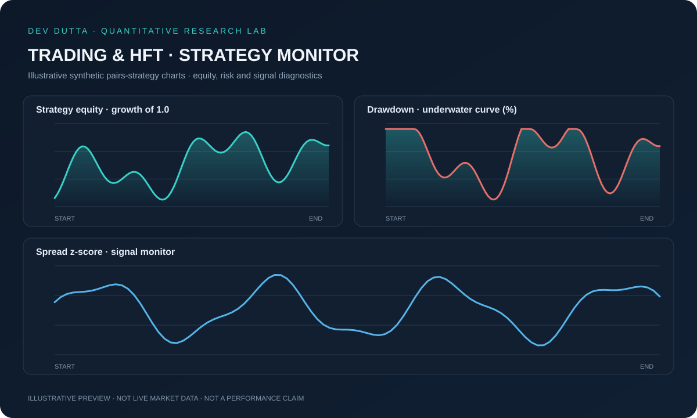
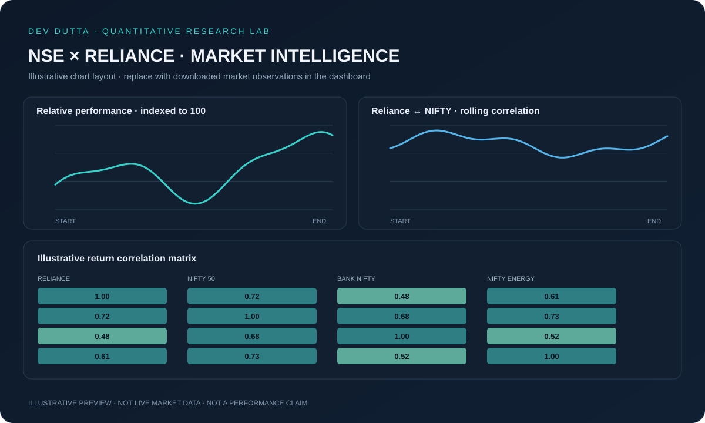

# Indian Equity & Index Futures: Quantitative Alpha Research and HFT Simulator

A reproducible research project connecting:
- **MF840 Financial Econometrics:** OLS hedge-ratio estimation, Engle-Granger cointegration diagnostics, spread construction and z-score signals.
- **MF796 Computational Methods:** numerical estimation, vectorized calculations and reproducible research workflow.
- **MF821 High-Frequency Trading:** simplified order-book execution, spread, displayed depth, market impact and order-flow imbalance.
- **NSE × Reliance market impact:** Reliance Industries' co-movement with NIFTY 50, NIFTY Bank and NIFTY Energy; HAC regressions, lead-lag tests, event studies and weight-based NIFTY contribution estimates.
- **Interactive trading dashboard:** dark institutional-style Streamlit terminal with strategy signals, equity/drawdown, auto-refreshing intraday market pulse, rolling correlations, return relationships, lead-lag sensitivity, portfolio construction, VaR/CVaR, rolling volatility, correlation analysis and stress testing.

> **Data note:** the included pairs strategy uses deterministic synthetic sample data. The NSE/Reliance dashboard downloads Yahoo Finance adjusted-price proxies. Neither source is official exchange-grade tick data or evidence of a profitable strategy.

## Visual chart previews

These previews are embedded directly in this README so the charts are visible on GitHub without launching Streamlit. They are **illustrative layouts using synthetic values**, not observed NSE returns or verified strategy performance. Launch the dashboard below to populate the NSE workspace with downloaded price data.

### Trading & HFT — strategy, risk and signals



### NSE × Reliance — relative performance and market linkage



## Launch the visual trading terminal

Python 3.10+:

~~~bash
python -m venv .venv
source .venv/bin/activate
pip install -r requirements.txt
streamlit run dashboard_app.py
~~~

The dashboard has eight workspaces:

### 1. Trading & HFT
- OLS log-price hedge ratio and rolling spread z-score
- Configurable lookback, entry/exit thresholds and turnover costs
- Lagged position-state chart
- Growth of 1.0 and underwater drawdown charts
- Simulated return, Sharpe and max drawdown summary

The strategy panel is a reproducible synthetic pairs-trading demonstration. It is not an actual NSE execution simulator and does not model queue priority, partial fills, latency, exchange fees, taxes or full market impact.

### 2. NSE × Reliance
- Reliance, NIFTY 50, Bank NIFTY and NIFTY Energy indexed performance
- Rolling Reliance–NIFTY correlation
- Return correlation heatmap
- Daily return scatter and OLS fit
- Reliance lead-lag sensitivity
- Date range and rolling-window controls
- Auto-refreshing intraday market pulse (1m / 5m / 15m / 60m bars), latest-bar price cards and indexed intraday chart
- Configurable refresh cadence and manual pull-latest control

The market workspace uses Yahoo Finance symbols as research proxies. Historical adjusted closes are fetched in bulk and cached for 15 minutes; the data explorer can separately fetch OHLCV history for candlestick, moving-average and volume charts. The intraday panel periodically refreshes recent bars while the app is open; choose 1m, 5m, 15m or 60m intervals and a 30–300 second refresh cadence. The refresh is provider polling, not a guaranteed real-time exchange stream. Yahoo Finance may delay, omit or rate-limit intraday data, and availability differs by symbol. Streamlit must remain running (locally or on a deployed host) for the dashboard to refresh; GitHub itself does not run the app.

The market workspace uses Yahoo Finance symbols as research proxies:
- Reliance Industries: `RELIANCE.NS`
- NIFTY 50: `^NSEI`
- NIFTY Bank: `^NSEBANK`
- NIFTY Energy: `^CNXENERGY` (may not be available from the provider)


### 3. Equity Markets
- Dedicated India and US equity universe with Indian large caps, additional NSE-listed equities, US mega caps and benchmark ETFs
- Custom Yahoo ticker input for additional listings and international symbols supported by the provider
- Daily or weekly adjusted OHLCV history, candlesticks, configurable moving averages, Bollinger Bands, RSI(14), MACD(12/26/9) and volume
- Multi-stock relative performance rebased to 100, return correlation, annualised volatility / mean-return summaries, and CSV exports for prices, returns and selected OHLCV
- Default coverage includes Reliance, TCS, Infosys, HDFC Bank, ICICI Bank, SBI, Bajaj Finance, Asian Paints, Titan, Wipro, NTPC, Apple, Microsoft, NVIDIA, Amazon, Alphabet, Meta, JPMorgan, Tesla, SPY and QQQ

The equity workspace fetches on demand and caches data for 15 minutes. Prices are adjusted provider history, not executable quotes or guaranteed real-time exchange data. Cross-market charts retain each security's local quote currency and do not convert INR/USD. yfinance documents Yahoo Finance access as intended for research/personal use; review provider terms and redistribution rights before publishing data.

### 4. Portfolio & Risk Lab
- Select market proxies and interactively allocate long-only portfolio weights (normalised to 100%)
- Portfolio growth, drawdown and rolling annualised volatility
- Historical VaR, CVaR and normal-parametric VaR at selectable confidence levels
- Sharpe ratio with adjustable annual risk-free rate and descriptive beta versus NIFTY 50
- Constituent correlation matrix and portfolio-return distribution
- Editable per-asset shock scenarios, illustrative capital-based P&L and downloadable risk/weight CSVs

Risk estimates are historical, sample-dependent and not forecasts. Parametric VaR assumes normally distributed returns; the simple shock model is linear and does not reprice options, liquidity or market impact. The portfolio lab uses Yahoo Finance adjusted-price proxies, not licensed exchange data.


- **INR contribution calculator:** enter current portfolio value and proposed fresh capital, then allocate the new money using existing stock weights, equal weights, or a custom split. It calculates rupee exposure, approximate added units, post-investment constituent weights, percentage-point weight changes, and historical portfolio volatility / 95% VaR / annualised-return comparisons. Excludes index, FX and commodity proxies from stock purchase allocation; excludes execution costs and fractional-share/lot-size constraints.
### 5. Multi-Asset Data Explorer
Selectable daily price history for a 23-instrument research universe:
- **Indian equities:** Reliance, TCS, Infosys, HDFC Bank, ICICI Bank, SBI, Axis Bank, Kotak Bank, L&T, ITC, Hindustan Unilever, Bharti Airtel, Tata Motors, Maruti and Sun Pharma.
- **Indian indices / volatility:** NIFTY 50, Bank NIFTY, NIFTY Energy and India VIX.
- **Cross-asset proxies:** USD/INR, Brent crude, WTI crude and gold.

Interactive views include latest available price/session move cards, rebased performance, OHLC candlesticks or close-price charts, configurable simple moving averages, reported volume, daily-return distributions, return correlation heatmaps, rolling pairwise correlation, annualised return/volatility, Sharpe (zero risk-free rate), max drawdown, best/worst day, observation coverage/missingness and downloadable price/return CSV files. Multi-symbol prices are requested in a bulk Yahoo Finance download; requests are cached for 15 minutes and users can force a refresh. Instruments are fetched only when selected. Provider symbols may be unavailable or return incomplete history; missing observations are retained rather than manufactured.

### 6. Futures & Options
- Yahoo Finance option-chain lookup for underlyings / expiries where Yahoo exposes them
- Calls and puts table with strike, last price, bid/ask, volume, open interest and implied volatility (when returned)
- Call OI, put OI, put/call OI ratio, strike-level OI chart and an OI-based expiry max-pain estimate
- Yahoo continuous futures proxy monitor for global contracts such as Brent, WTI, gold, silver, natural gas, E-mini S&P 500 and 10-year Treasury note
- **NSE index-futures daily bhavcopy importer:** accepts the official UDiFF Common Bhavcopy Final ZIP (or extracted CSV) and common legacy futures CSV headers; extracts and filters `FUTIDX` contracts for NIFTY, BANKNIFTY and FINNIFTY
- Header mapping into a normalized schema: `Date, Symbol, InstrumentType, Expiry, Open, High, Low, Close, LastPrice, SettlePrice, Volume, Turnover, OpenInterest, ChangeInOI, UnderlyingValue`
- Daily front-month close series, expiry-wise contract snapshots, aggregate volume / open-interest / change-in-OI charts, days-to-expiry, daily contract returns, and settlement-minus-underlying basis when source fields exist
- Normalized CSV template download and cleaned futures dataset export
- NSE options CSV import with strike-level CE/PE open-interest analysis and downloadable cleaned data


#### NSE index futures daily bhavcopy workflow

Use the NSE website's **All Reports → F&O → UDiFF Common Bhavcopy Final (ZIP)** report. Upload the ZIP directly in the dashboard's **Futures & Options → NSE index futures · daily** tab, or upload the extracted CSV. The importer maps UDiFF fields and common legacy headers, filters index-futures instrument type `FUTIDX`, and retains NIFTY, BANKNIFTY and FINNIFTY. It also provides a normalized CSV schema template for vendor files. A repository copy is available at [`data/nse_index_futures_template.csv`](./data/nse_index_futures_template.csv).

| Normalized field | UDiFF header commonly mapped | Meaning |
|---|---|---|
| Date | `TradDt` / `BizDt` | Trade / business date |
| Symbol | `TckrSymb` | NIFTY, BANKNIFTY or FINNIFTY |
| InstrumentType | `FinInstrmTp` | Index futures filter: `FUTIDX` |
| Expiry | `XpryDt` | Contract expiry |
| Open / High / Low / Close | `OpnPric` / `HghPric` / `LwPric` / `ClsPric` | Daily contract OHLC |
| SettlePrice | `SttlmPric` | Daily settlement price |
| Volume | `TtlTradgVol` | Traded contract volume |
| Turnover | `TtlTrfVal` | Reported turnover field |
| OpenInterest / ChangeInOI | `OpnIntrst` / `ChngInOpnIntrst` | End-of-day OI and daily OI change |
| UnderlyingValue | `UndrlygPric` | Underlying index value, where present |

The importer calculates days to expiry and contract-level daily close returns. It identifies the front month as the nearest expiry on or after each trade date. This front-month series is **not back-adjusted**: expiry rolls can create discontinuities. Basis is calculated as settlement price minus underlying value only when both fields are present. Daily bhavcopy data is end-of-day data, not tick or intraday data. Verify source headers and units against the exchange's current UDiFF catalogue before vendor-specific use.

Official source: [NSE All Reports – Derivatives](https://www.nseindia.com/all-reports-derivatives). NSE identifies the UDiFF Common Bhavcopy Final ZIP as the current F&O bhavcopy report and marks the older common bhavcopy CSV as discontinued.

**Critical data limitation:** Yahoo Finance does not reliably expose complete NSE stock/index futures and options chains. NSE option-chain availability through Yahoo may be empty for Indian underlyings; use the NSE data import tab with an exchange or licensed-vendor CSV for actual NSE derivatives. Yahoo continuous futures tickers are stitched global proxy series, not specific NSE expiries or executable contracts. Uploaded data is analysed as supplied and should be checked against the original exchange file. PCR and max pain are descriptive statistics, not trading signals.


### 8. Stochastic Calculus & Astro-Market Research
- **GBM simulator:** configurable initial price, drift, volatility, horizon, path count, time steps and reproducible random seed; simulated paths and terminal-price distribution are compared with analytical GBM moments.
- **Itô's lemma calculator:** analytic first/second spatial derivatives and time derivative for log-price, squared-price, square-root and power-exponential functions; computes the local drift and diffusion coefficients under GBM.
- **Crude and gold event study:** fetches Brent crude and gold continuous-futures research proxies from Yahoo Finance, accepts a user-uploaded planetary-event calendar, maps events to the next available trading session, and calculates +1/+3/+5/+10-session forward returns by body and event type.
- Downloadable event-study output and a CSV template with columns `date,body,event`.

**Astrology disclaimer:** planetary event dates are user supplied; the dashboard does not calculate ephemerides or claim that planetary movements predict markets. The overlay is a speculative descriptive event study, not an established forecasting method. Event clustering, multiple testing, overlapping windows and macroeconomic confounders can produce spurious associations. GBM is a simplified constant-parameter model and is not a commodity-pricing model; futures carry, storage, convenience yield, seasonality, rolls and jumps are omitted.

### 7. NSE · BSE · Yahoo data pipelines
- Dedicated pipeline control room with independent NSE, BSE and Yahoo connection status
- Yahoo Finance reference-series fetcher with symbol, interval and lookback controls
- Configurable NSE and BSE REST/CSV feed adapters for endpoints supplied by the user under their exchange or vendor agreement
- Feed response preview and CSV export; no silent substitution between data vendors
- Credentials are read from environment variables or Streamlit secrets, never hard-coded

Configure these Streamlit secrets (use the endpoint and authentication format provided by your licensed vendor):
```toml
NSE_FEED_URL = "https://your-approved-nse-vendor-endpoint"
NSE_API_TOKEN = "your-token"
BSE_FEED_URL = "https://your-approved-bse-vendor-endpoint"
BSE_API_TOKEN = "your-token"
```
The generic adapter currently expects an HTTP GET response containing JSON records or CSV. A vendor-specific adapter may be needed for WebSocket, OAuth, signed requests, SFTP, binary snapshots or a different response schema. Do not paste credentials into GitHub or chat.

**Operational distinction:** Streamlit's periodic reruns are not an always-on ingestion service. For durable continuous pipelines, deploy a separate worker, persist incoming licensed data to a database, and let Streamlit query that store. Yahoo Finance is a research proxy and may be delayed, rate-limited or incomplete. NSE and BSE data access, display and redistribution are governed by exchange/vendor agreements; configure only a feed you are entitled to use.

## Run the econometric analysis to CSV

~~~bash
python nse_reliance_analysis.py --start 2018-01-01
~~~

For historical index attribution, first populate an official historical constituent-weight file using the schema in `data/reliance_index_weights_template.csv`, then run:

~~~bash
python nse_reliance_analysis.py --start 2018-01-01 --weights data/reliance_index_weights.csv --events data/reliance_events.csv
~~~

Outputs include daily log returns, a correlation matrix, HAC-robust market regressions, lagged-return regressions, and (when official weights are supplied) an estimated Reliance contribution and NIFTY-ex-Reliance return series.

**Important:** correlation and regression beta measure co-movement, not causal influence. A lagged coefficient is not automatically tradable alpha. NIFTY contribution is a first-order approximation; exact attribution requires official constituent weights and index calculation data. Yahoo Finance is only a convenient research proxy; validate results with licensed NSE/vendor data before presenting market conclusions.

## Original strategy methodology

1. Estimate the log-price hedge ratio on the first 60% of observations.
2. Run an Engle-Granger diagnostic on the training sample.
3. Calculate the residual spread and trailing z-score on the holdout sample.
4. Enter at |z| >= 2 and exit at |z| <= 0.5.
5. Lag positions one bar and deduct a configurable turnover cost.
6. Separately estimate marketable-order fills from a top-of-book snapshot.

## Repository layout

- `dashboard_app.py` — interactive eight-workspace trading dashboard
- `stochastic_astro_lab.py` — GBM simulation, Itô coefficient calculator and crude/gold event-study workspace
- `.streamlit/config.toml` — visual theme
- `generate_sample_data.py` — deterministic synthetic sample generator
- `nse_reliance_analysis.py` — NSE/Reliance market-linkage research
- `NSE_RELIANCE_RESEARCH.md` — research design and interpretation guide
- `data/` — historical index-weight, corporate-event and NSE index-futures CSV templates
- `src/india_quant/` — data validation, econometrics, backtest, metrics and execution modules
- `tests/` — unit tests
- `requirements.txt` — dependencies

**No profitability or causal-impact claim is made.**
