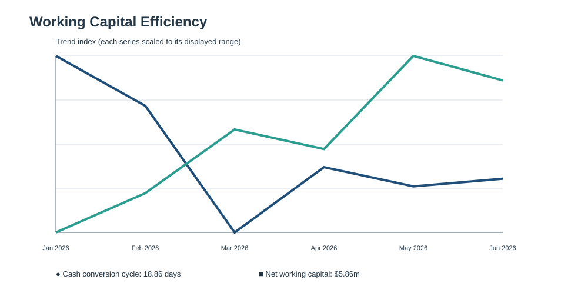
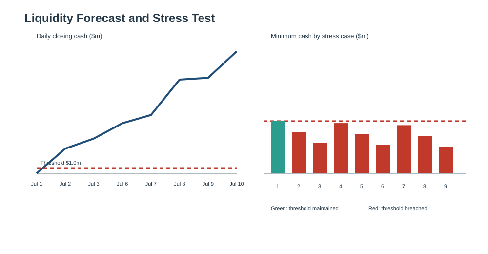
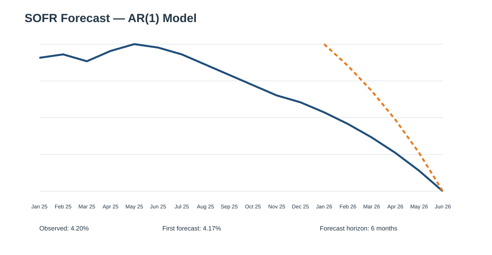
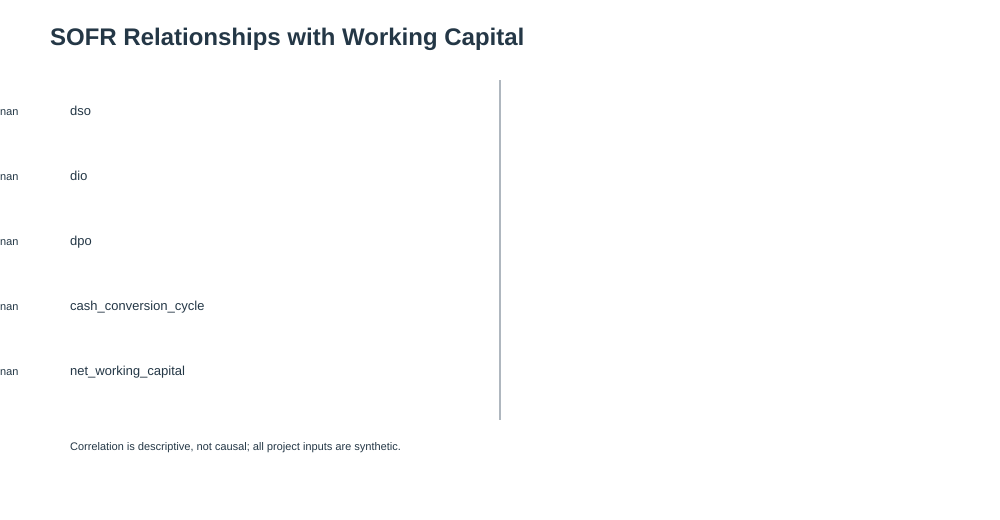
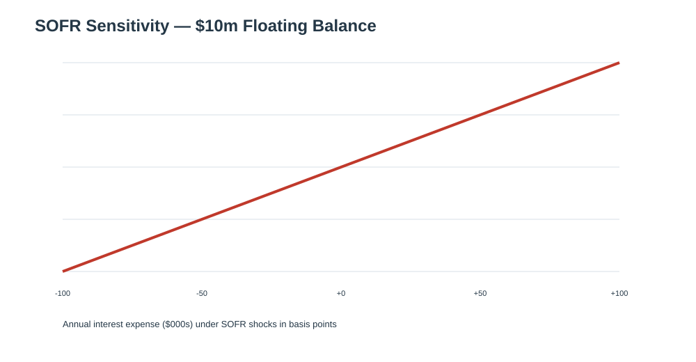

# Treasury Working Capital Analytics

A compact Python portfolio project for measuring working-capital efficiency and assessing short-term liquidity risk. It uses **entirely synthetic data** designed to resemble a mid-sized operating company; it does not contain real company, customer, or banking information.

## What it does

- Calculates **DSO, DIO, DPO, cash conversion cycle (CCC), and net working capital (NWC)** from monthly balance and income-statement data.
- Builds a dated, rolling cash-balance forecast from signed cash transactions.
- Runs a grid of collection and disbursement stress cases against a liquidity threshold.
- Runs a reproducible Monte Carlo simulation to estimate the probability of a liquidity-threshold breach.
- Forecasts **SOFR** with a transparent AR(1) model and a 95% prediction interval.
- Measures descriptive SOFR relationships with DSO, DIO, DPO, CCC and NWC.
- Runs SOFR shock sensitivity for illustrative floating-rate interest expense.
- Produces reusable CSV report tables and presentation-ready charts through one command.
- Adds an illustrative bank-credit review of leverage, coverage, liquidity, covenant headroom, stress sensitivity, and refinancing timing.

## Project layout

```text
treasury-working-capital/
├── data/                 # Clearly labelled synthetic CSV inputs
├── src/
│   ├── working_capital.py
│   ├── cash_forecast.py
│   ├── scenario_analysis.py
│   ├── credit_risk.py
│   ├── sofr_analysis.py          # SOFR forecasting + sensitivity
│   ├── sofr_visualizations.py    # SOFR graphical analysis
│   ├── visualizations.py
│   └── main_analytics.py
├── reports/              # Generated tables and GitHub-viewable chart images
├── tests/
├── requirements.txt
└── README.md
```

## Quick start

```bash
cd treasury-working-capital
python -m venv .venv
source .venv/bin/activate        # Windows: .venv\\Scripts\\activate
pip install -r requirements.txt
python src/working_capital.py
python src/cash_forecast.py
python src/scenario_analysis.py
python src/main_analytics.py
python -m pytest
```

## Analytics report

Run `python src/main_analytics.py` to regenerate the files in `reports/`. The command writes working-capital, liquidity, credit-risk and SOFR CSV tables, plus presentation-ready SVG charts.

### Working-capital trend



### Liquidity stress test



### SOFR forecast



### SOFR relationships



### SOFR interest-rate sensitivity



## SOFR methodology

`src/sofr_analysis.py` uses a deliberately transparent AR(1) model:

**SOFR(t) = α + β × SOFR(t−1) + ε(t)**

The bundled monthly observations are synthetic. The model produces a six-month point forecast and a simple 95% prediction interval based on the historical regression residual volatility. This is a portfolio demonstration rather than a production interest-rate forecast.

The relationship analysis joins the synthetic SOFR series to the project's monthly working-capital metrics and reports Pearson correlations. These correlations are **descriptive, not causal**. The sensitivity analysis translates SOFR shocks into annual interest expense for illustrative $5m, $10m and $25m floating-rate balances.

## Metric definitions

All monthly flows are annualised using a 365-day convention.

| Metric | Formula |
| --- | --- |
| DSO | Accounts receivable / annualised sales × 365 |
| DIO | Inventory / annualised COGS × 365 |
| DPO | Accounts payable / annualised COGS × 365 |
| CCC | DSO + DIO − DPO |
| NWC | Accounts receivable + inventory − accounts payable |

## Bank credit and default-risk perspective

The `data/credit_inputs.csv` file is the borrower input sheet. It captures synthetic debt, cash, undrawn facility, EBITDA, interest, debt service, maturity, and covenant limits. `src/credit_risk.py` evaluates the following bank-review inputs:

| Credit input | Bank-review purpose |
| --- | --- |
| Net leverage | Debt burden relative to recurring earnings |
| Interest coverage | Capacity to pay interest from earnings |
| Debt-service coverage | Capacity to pay contractual debt service |
| Minimum cash and undrawn facility | Liquidity cushion and reliance on committed funding |
| Liquidity stress cases | Resilience when collections fall or outflows rise |
| Debt maturity | Refinancing risk and time available to address it |
| Covenant limits | Early-warning signals and contractual headroom |

The resulting `credit_tests.csv` and `credit_risk_summary.csv` are written to `reports/tables/`. The **indicative risk score is not a probability of default (PD)** and must not be used as a lending decision, rating, or regulatory model. A real bank would calibrate PD using historical defaults, borrower-specific cash flows, collateral, sector conditions, legal documentation, and its own credit policy.

## Assumptions and interpretation

The sample cash forecast begins with $1.5m of cash and applies transactions on their stated dates. Scenario analysis applies percentage shocks to positive cash flows (collections) and negative cash flows (outflows); a breach means cash falls below the selected threshold. The Monte Carlo model applies independent normal shocks to daily net cash flow. The credit review prioritises repayment capacity under stress, consistent with supervisory credit-risk principles. It is an illustrative planning tool, not a production liquidity model, lending decision, or investment recommendation.

## Extending the project

Replace the synthetic CSVs with approved internal data, add an official SOFR data feed such as the Federal Reserve Bank of New York's published series, consider OLS/ARIMA/state-space models and out-of-sample backtesting, and calibrate rate shocks from historical volatility before using it for decisions.
